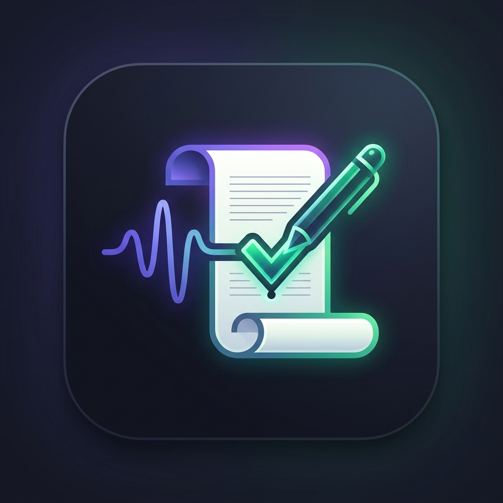

# Script Corrector (口播稿校对工具-法语) `v1.0.0`

<p align="center">
  <br/><br/>
  <a href="https://aistudio.google.com/">
    
  </a>
</p>

一个专为口播音频、演讲和神学录音打造的高精度语音转录与字幕智能校对工具。系统结合 **Gladia ASR** 语音识别与 **Google Gemini** 大语言模型，针对原始文案与实际发音进行“双重标准”智能对齐校正，并提供符合现代影视/自媒体规范的自动化字幕断行与 SRT/TXT 导出能力。

---

## 🚀 一键部署与在线访问 (One-Click Deploy & Access)

### GitHub 仓库一键导入到全新 AI Studio 项目
如果您希望将本项目复制或一键导入到自己的 Google AI Studio 账号中运行：

1. **直接导入**：
   - 打开 [Google AI Studio 控制台 (aistudio.google.com)](https://aistudio.google.com/)；
   - 点击左侧菜单栏的 **Build** -> **Import from GitHub**；
   - 粘贴本项目的 GitHub 仓库链接，点击导入确认。
2. **零配置自动初始化**：
   - 平台将自动识别项目配置 (`metadata.json` 与 `package.json`)；
   - 自动拉取依赖、挂载服务端 Gemini API 凭证通道；
   - 弹出 `Enter your environment variable to continue: GLADIA_API_KEY` 提示，填入您的 Gladia Key 即可在 1 分钟内完成全量部署与启动！

---

## ⚠️ 重要说明：Gemini API 与部署环境

> **核心提示**：本项目针对 **Google AI Studio** 托管环境进行了深度定制与集成（具备 `MAJOR_CAPABILITY_SERVER_SIDE_GEMINI_API` 能力）。

### 1. 部署在 Google AI Studio 环境
- **免去自行配置/管理外部 Gemini API 服务的开销**：当项目在 Google AI Studio 内部部署与运行时，平台服务会在容器运行时自动通过内部机制注入与托管 Gemini API 凭证，无需在客户端暴露密钥，也无需自行搭建复杂的第三方 LLM API 转发代理或单独维护外部账单。
- 平台自动管理运行时生命周期，实现服务端安全的开箱即用。

### 2. 部署在非 Google AI Studio 外部环境（如自建 VPS、Docker、Vercel 等）
- 外部环境**无法**享受 Google AI Studio 平台的内置 Gemini 凭据托管服务。
- 您**必须**在服务器环境变量或 `.env` 文件中显式配置您自行申请的 `GEMINI_API_KEY`，否则后端在调用 `/api/correct` 进行文本校正时将抛出 `500` 错误并提示未配置有效密钥。

---

## 📖 使用操作说明 (Step-by-Step Guide)

### 步骤 1：配置 Gladia API 密钥 (平台初始弹窗)

当您在 Google AI Studio 中首次启动或重新加载应用时，界面通常会提示输入所需的环境变量：

> 💬 **平台弹窗提示**：
> ```text
> Enter your environment variable to continue
> GLADIA_API_KEY
> ```

1. **获取密钥**：前往 [Gladia 官方控制台 (app.gladia.io)](https://app.gladia.io/) 注册并复制您的 API Key。
2. **填入并保存**：在 AI Studio 弹出的环境变量输入框中粘贴该 Key，确认保存即可完成后端环境配置。
3. *(备用方案)*：如果您在弹窗阶段跳过了配置，亦可在页面左侧面板的 **“Gladia API Key (可选)”** 输入框中直接粘贴临时 Key，系统将自动优先采用前端填写的自定义 Key。

---

### 步骤 2：上传口播音频文件 (Text A 来源)

1. 点击或拖拽您的法语口播录音文件至 **“上传音频文件”** 区域。
2. 支持格式：`.mp3`, `.wav`, `.m4a`, `.aac`, `.ogg`, `.webm`, `.flac`（单文件限制 50MB）。
3. 上传后，浏览器会自动解析该音频的**精确总播放时长**，用于后续自适应分配生成 SRT 字幕时间轴。

---

### 步骤 3：输入文案原稿 (Text B)

1. 在左侧面板的 **“文案原稿 (文本 B)”** 文本框中粘贴标准文字稿。
2. 建议文稿包含标准的法语圣经经文引用（如法语引号 « ... »、神性代词大写 Il / Lui 等），以便后续智能校对引擎严格执行神学标准。

---

### 步骤 4：调整字幕排版参数 (可选定制)

展开 **“字幕排版设置”** 面板，可按您的视频规范自定义：
- **启用字幕排版优化与强制断行**：开启后校正文本将严格按行切分输出；
- **单行最大字符数**：默认 32（推荐 28 ~ 36 字符，适配横竖屏视频阅读）；
- **单行最小字符数**：默认 12（避免单个词独立成行）；
- **避开视觉盲区区间**：默认开启（避免单行字数落在 25~30 之间产生视觉不协调）；
- **显示每行字符统计**：实时在文本行左侧标出行长数字。

---

### 步骤 5：一键开始智能校对

点击底部的 **“开始智能校对 (Start Processing)”** 按钮，系统将自动执行全流程处理：

1. **阶段一 · 语音识别 (ASR)**：音频自动上传至 Gladia 进行快速转录，结果显示在中间的 **“原始识别结果 (文本 A)”**；
2. **阶段二 · 双重标准智能校正 (Gemini 3.6 Flash)**：服务端将文本 A 与文本 B 送入 Gemini 智能引擎，经文严格遵从文本 B，口语讲解忠实还原语音，修正同音词错漏并完成自动断行，输出最终的 **“校正结果 (文本 C)”**；
3. **差异报告**：右下角面板自动生成中文的改词、漏词、加词对比解析。

> 💡 *效率提示*：若仅调整了文本稿或断行参数，无需重新上传音频，直接点击 **“仅重新校对文本 (Gemini Only)”** 即可秒级重新生成校对结果。

---

### 步骤 6：核对与导出字幕文件

校对完成后，在右侧面板支持以下导出方式：
- **复制文本 C**：一键将规整的字幕文本复制到剪贴板；
- **导出 SRT 字幕文件 (`.srt`)**：基于音频真实时长与各行字数比重自适应生成标准 SRT 时间轴，可无缝导入**剪映 (CapCut)、Adobe Premiere Pro、Final Cut Pro、DaVinci Resolve** 等主流剪辑软件；
- **导出时间戳文本 (`.txt`)**：生成带序号与时间区间的排版文本记录。

---

## 🌟 核心特性

1. **精准语音转录 (ASR)**：
   - 基于 Gladia Speech-to-Text 引擎，支持 MP3, WAV, M4A, AAC, OGG 等常见音频格式。
   - 支持后端预设系统级 Gladia API Key，亦支持用户在前端临时填入个人自定义 Key。

2. **“双重标准”神学文本智能校正 (Gemini 3.6 Flash)**：
   - **经文与神话语 (Strict Mode)**：严格 100% 对齐原始文案（文本 B），包括标点（法语引号 « ... »）、神性代词大写（Il, Son, Lui 等）与圣经章节规范。
   - **口语讲解/非经文部分 (Faithful Mode)**：忠实还原语音（文本 A）真实口语表达，保留说话人真实连接词，仅修正同音词、变位错漏等 ASR 错误。
   - 自动生成中文差异对比报告（改词、加词、漏词分析）。

3. **字幕规范自动排版与排版避险**：
   - 可配置每行最大字符数（推荐 28~36 字符）与最小字符数。
   - 智能语法停顿断行，避免悬挂介词/冠词。
   - 视觉排版避险算法，避开易造成视觉不协调的行长区间。

4. **多格式字幕导出**：
   - **SRT 字幕文件**：根据音频真实时长或自然阅读语速自动生成精确时间戳。
   - **TXT 文本文件**：带有序号与时间区间排版的纯文本记录。

---

## 🛡️ 安全架构设计

本项目已完成全面的应用安全工程加固：
- **Prompt 闭环管理**：提示词构建逻辑完全收拢于服务端受信环境，前端仅传输结构化文本参数，彻底杜绝外部任意 Prompt 注入与未授权 LLM 代理滥用。
- **音频文件白名单**：Multer 严格限制上传文件为合法音频 MIME 类型与扩展名，限制单文件最大 50MB。
- **内存 DoS 防护**：全局 JSON 与 URL-encoded 限制为 2MB，防止恶意大包打满 Node.js V8 堆内存。
- **智能速率限制 (Rate Limiting)**：
  - `/api/transcribe` 限制单 IP 每分钟 12 次请求。
  - `/api/correct` 限制单 IP 每分钟 20 次请求。
- **网络反向代理与传输安全**：
  - 启用 `trust proxy`，精确识别多层网关下的客户端真实 IP。
  - 上游轮询接口严格执行 HTTPS 协议与域名双重校验。
- **依赖供应链 0 漏洞**：全量锁文件经过深度 CVE/GHSA 修复与验证（`npm audit: 0 vulnerabilities`）。

---

## 🛠️ 环境变量说明

复制 `.env.example` 为 `.env`：

```bash
# Gemini API Key（在 Google AI Studio 中会自动注入；在外部自建部署时必须提供）
GEMINI_API_KEY="YOUR_GEMINI_API_KEY"

# Gladia API Key（用于语音转录）
GLADIA_API_KEY="YOUR_GLADIA_API_KEY"

# 应用运行公网地址（由平台自动注入）
APP_URL="YOUR_APP_URL"
```

---

## 🚀 本地开发与构建

### 安装依赖
```bash
npm install
```

### 启动开发服务器
```bash
npm run dev
```
> 服务将在 `http://localhost:3000` 启动，后端 API 与 Vite 前端中间件协同运行。

### 生产环境编译构建
```bash
npm run build
```

### 类型与代码质量检查
```bash
npm run lint
```
